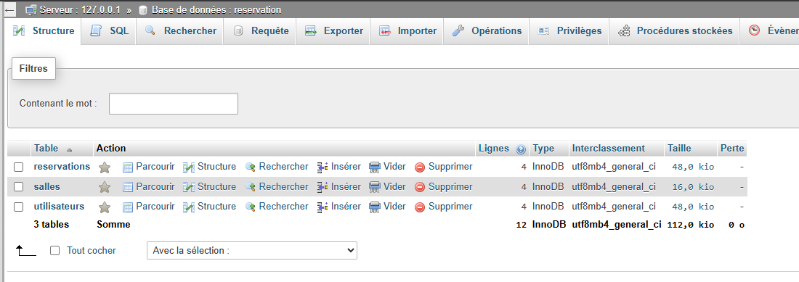
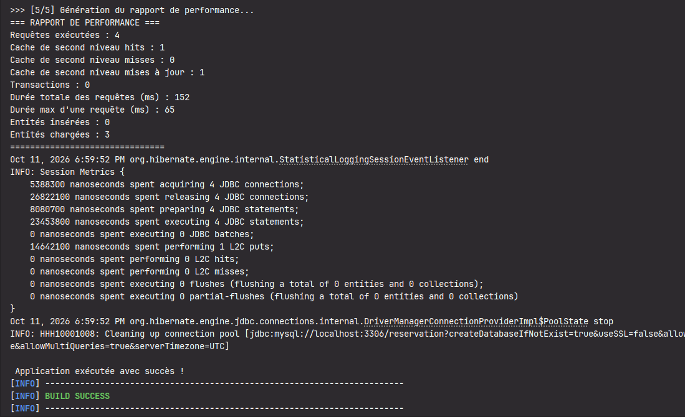
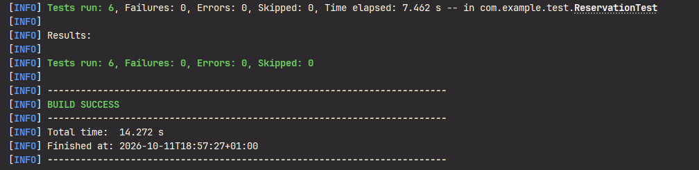

# TP Capstone : Application "Réservation de salles" avec JPA & Hibernate

Application JEE pure (sans Spring) implémentant la gestion complète des réservations de salles avec JPA 2.2 et Hibernate 5.6.

---

## 🎯 Objectifs & Fonctionnalités Implémentées

1. **Modèle de données relationnel complet** :
   - [Utilisateur](file:///d:/DGSI/JEE/TP_Capstone/src/main/java/com/example/model/Utilisateur.java) : `@Entity`, `@Table(name = "utilisateurs")`, `@Cacheable`, `@Version` (optimistic locking).
   - [Salle](file:///d:/DGSI/JEE/TP_Capstone/src/main/java/com/example/model/Salle.java) : `@Entity`, `@Table(name = "salles")`, `@Cacheable`, `@Version`.
   - [Reservation](file:///d:/DGSI/JEE/TP_Capstone/src/main/java/com/example/model/Reservation.java) : `@Entity`, `@Table(name = "reservations")`, `@ManyToOne(fetch = FetchType.LAZY)` vers `Salle` et `Utilisateur`, `@Version`.

2. **Cache de second niveau (L2 Cache) & Configuration avancée** :
   - Intégration JCache (`org.hibernate.cache.jcache.JCacheRegionFactory`) avec **Ehcache 3** (`org.ehcache.jsr107.EhcacheCachingProvider`).
   - Configuration dans [persistence.xml](file:///d:/DGSI/JEE/TP_Capstone/src/main/resources/META-INF/persistence.xml) et [ehcache.xml](file:///d:/DGSI/JEE/TP_Capstone/src/main/resources/ehcache.xml).
   - Stratégie `READ_WRITE` avec `@org.hibernate.annotations.Cache`.
   - Cache de requêtes (`hibernate.cache.use_query_cache = true`).

3. **Jeu de données réaliste** :
   - [DataInitializer](file:///d:/DGSI/JEE/TP_Capstone/src/main/java/com/example/util/DataInitializer.java) : insertion de 4 utilisateurs, 4 salles et 4 réservations avec dates dynamiques (`LocalDateTime.now().plusDays(...)`).
   - Gestion de l'idempotence pour éviter les doublons sur les contraintes uniques.

4. **Script & Exécuteur de Migration JDBC** :
   - Script SQL : [v2_0_add_description.sql](file:///d:/DGSI/JEE/TP_Capstone/src/main/resources/db/migration/v2_0_add_description.sql).
   - [MigrationExecutor](file:///d:/DGSI/JEE/TP_Capstone/src/main/java/com/example/util/MigrationExecutor.java) : exécution du script SQL directement via JDBC, gestion des commentaires et de l'idempotence.

5. **Optimisation des requêtes (JPQL & Criteria API)** :
   - [ReservationService](file:///d:/DGSI/JEE/TP_Capstone/src/main/java/com/example/service/ReservationService.java) :
     - Requête JPQL paramétrée : `findReservationsBySalleAndDate`.
     - Requête Criteria API type-safe : `findReservationsCriteria`.
     - Algorithme de vérification des conflits de créneaux : `isSalleDisponible`.

6. **Transactions, Verrouillage Optimiste & Gestion des logs** :
   - Transactions `RESOURCE_LOCAL` avec `begin()`, `commit()`, et `rollback()` en bloc catch.
   - Gestion de l'exception `OptimisticLockException` déclenchée par `@Version`.
   - Journalisation standard JEE avec `java.util.logging.Logger`.

7. **Rapport de performance Hibernate** :
   - [PerformanceReport](file:///d:/DGSI/JEE/TP_Capstone/src/main/java/com/example/util/PerformanceReport.java) exploitant l'API `Statistics` d'Hibernate.
   - Affichage des hits/misses du cache L2, nombre de requêtes SQL, durée d'exécution et transactions.

8. **Tests unitaires et fonctionnels JUnit 5** :
   - [ReservationTest](file:///d:/DGSI/JEE/TP_Capstone/src/test/java/com/example/test/ReservationTest.java) couvrant :
     - Création d'une réservation.
     - Validation du fonctionnement du cache de second niveau (L2 hits).
     - Test de concurrence et déclenchement d'un conflit de verrouillage optimiste (`@Version`).
     - Requêtes JPQL et Criteria API.
     - Détection des conflits de chevauchement horaire.
     - Suppression d'une réservation.

---

## 📸 Extraits et Captures d'Écran des Résultats

### 1. Vérification des Tables et Données dans phpMyAdmin / MySQL
Structure de la base de données `reservation` après exécution de la migration et initialisation des données :

- **Tables créées** : `reservations`, `salles`, `utilisateurs`.
- **Lignes insérées** : 4 enregistrements dans chaque table (total de 12 entités persistées).

---

### 2. Exécution de MainApp et Rapport de Performance Hibernate (`mvn compile exec:java`)
Sortie console de l'orchestration principale montrant le rapport de performance et les métriques de session :

*(Fichier source : [src/Screenshot 2026-10-11 180040.png](file:///d:/DGSI/JEE/TP_Capstone/src/Screenshot%202026-10-11%20180040.png))*

- **Métriques clés** :
    - `Cache de second niveau hits : 1` (entité résolue depuis Ehcache sans nouvelle requête SQL).
    - `Cache de second niveau misses : 0`.
    - `Durée totale des requêtes : 152 ms` / `Durée max : 65 ms`.
    - Résultat global : `BUILD SUCCESS`.

---
### 3. Validation des Tests Automatisés JUnit 5 (`mvn test`)
Exécution complète de la suite de tests validant la persistance, le cache L2, le verrouillage optimiste et la détection des conflits :

- **Bilan** : 6 tests exécutés, 0 échec, 0 erreur (`BUILD SUCCESS`).

---